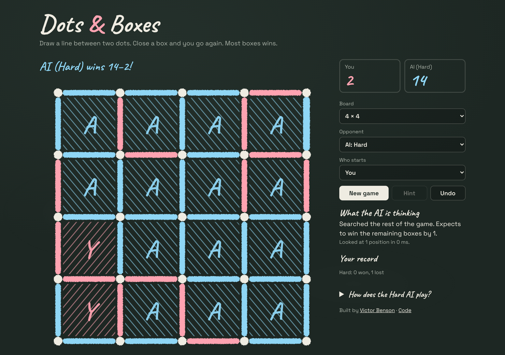

# Dots & Boxes, against a minimax AI

**Play the classic pencil-and-paper game against an AI with three levels.** The Hard level searches the rest of the game with **negamax, alpha-beta pruning and a transposition table**. It finds the expert tricks (the long chain rule and double-dealing) by itself.

[](https://github.com/macroer16/dots-and-boxes/actions/workflows/ci.yml)



## Features

- **3×3, 4×4 and 5×5 boards.** Play the AI (Easy, Medium or Hard) or a friend on the same screen.
- **"What the AI is thinking"** explains every move, for example: *"Declined free boxes on purpose (a double-deal) to keep control of the next chain"*, *"Looked at 48,210 positions in 120 ms"*.
- **Hint** (`H`) asks Hard for the best move and highlights it. **Undo** (`U`) takes back your last line.
- **Keyboard play:** arrow keys pick a line, Enter draws it. It works on touch screens too.
- **Your record** against each level is saved in your browser.
- **The AI runs in a Web Worker,** so the board never freezes while Hard thinks.

## The three levels

| Level | How it plays |
| --- | --- |
| **Easy** | Usually takes a box when it can; otherwise plays anywhere, even if that hands you boxes |
| **Medium** | Takes boxes, plays "safe" lines (never the third side of a box), then gives away the smallest chain it can |
| **Hard** | Medium's opening, then an exact search to the end of the game once the board is small enough |

**Measured strength** (alternating who starts): Hard beat Medium **20–0** on 3×3, **11–0** (1 draw) on 4×4 and **9–3** on 5×5. The slowest Hard move was about 1 second. The details and benchmarks are in [ARCHITECTURE.md](ARCHITECTURE.md).

## Run it

```bash
git clone https://github.com/macroer16/dots-and-boxes && cd dots-and-boxes
npm install
npm run dev        # http://localhost:5173
npm test           # rules, AI behaviour and tournaments
npm run bench      # speed and strength benchmarks
```

## Docs

- [ARCHITECTURE.md](ARCHITECTURE.md): board representation, turn flow, the search, and the speed-up from make/unmake
- [RESEARCH.md](RESEARCH.md): the strategy research behind the three levels

Built with TypeScript, Vite, SVG and Web Workers. No game engine and no images: the chalk look is an SVG filter.

---

Built by [Victor Benson](https://victor-benson.vercel.app), BSc Computer Science, University of Westminster. MIT licence.
